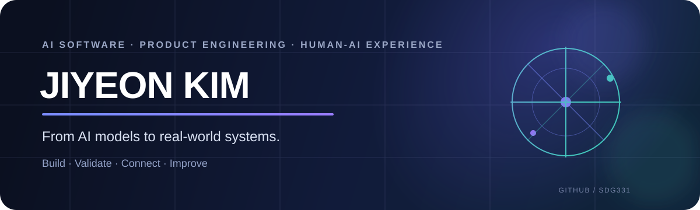

## Hello, I'm Jiyeon.

동양미래대학교 인공지능소프트웨어학과에서 공부하는 **김지연**입니다.  
AI를 웹·하드웨어와 연결해, 사용자가 직접 경험하는 제품과 시스템을 만듭니다.

## Selected Work

| Project | What I'm Building |
| --- | --- |
| **[MirrorTing](https://github.com/DMUCarpeDM/2026CarpeDM_EXPO)** · [ID Printer](https://github.com/sdg331/CarpeDM_EXPO_IDPrinter) | AI 업무 대화 연습용 스마트미러와 얼굴·NFC·출력 체험 키오스크 · **Team CarpeDM** |
| **[생강 · Ginger](https://github.com/sdg331/ginger-app)** | 후속 질문과 수정 전후 비교로 생각을 발전시키도록 돕는 사고 훈련 **MVP** |
| **[틈길 · TEUMGIL](https://github.com/sdg331/Teumgil)** | 전통시장 탐색·장보기·시민과 상인의 의견 흐름을 연결하는 가상 자료 기반 **MVP** · 길이음팀 |
| **[근거노트](https://github.com/sdg331/evidence-note)** | 답변의 근거·쪽수·발췌를 확인하는 샘플 문서 기반 한국어 Q&A **데모** |
| **[ReliefCheck](https://github.com/sdg331/CarpeDM_EswContest)** | Raspberry Pi·NFC 기반 오프라인 우선 구호물자 지급 단말 **프로토타입** · 팀 프로젝트 |

프로젝트별 구현 내용과 검증 범위는 각 저장소에 정리했습니다.

## Core Stack

`Python` · `TypeScript` · `React / Next.js` · `FastAPI` · `scikit-learn` · `PostgreSQL / SQLite` · `Raspberry Pi`

## Awards

- **2026 · 우수상** — 학생참여형 리빙랩 활동 지원 프로그램
- **2026 · 우수상** — 태일씨앤티 웹사이트 리뉴얼 경진대회
- **2025 · 동상** — 한국실천공학회 교육장비개발대회
- **2025 · 동상** — AI로 만드는 우리 대학 이야기 공모전

---

[GitHub @sdg331](https://github.com/sdg331)
